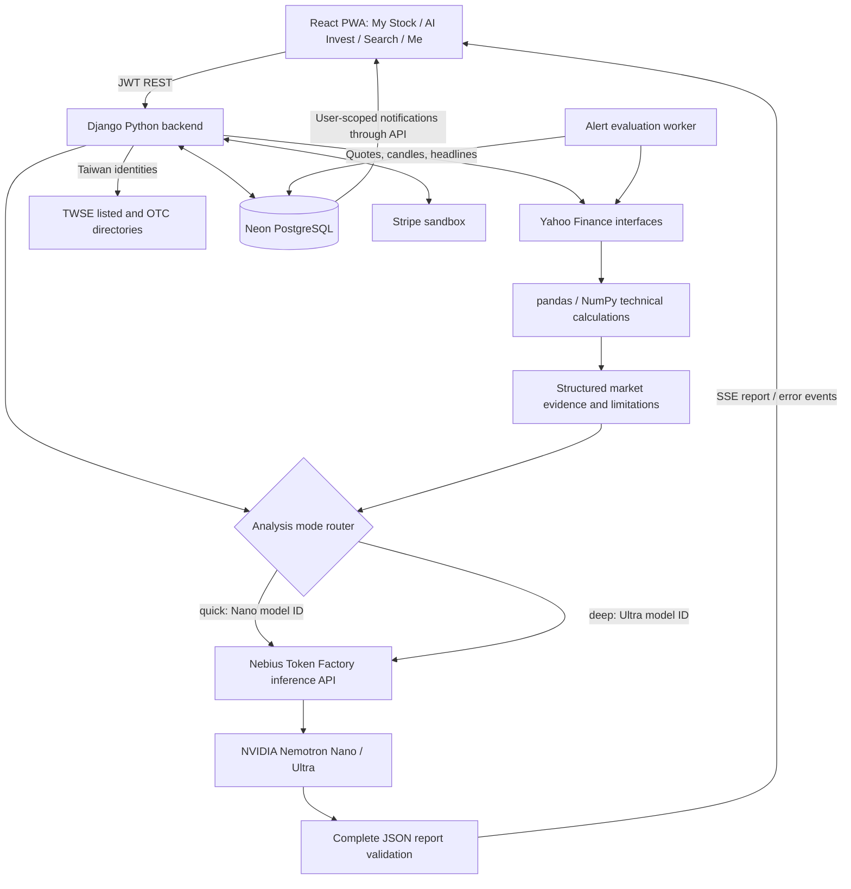

# Picking Geek AI - Investing Made Easy

**A financial data-grounded research copilot for US and Taiwan markets, powered by NVIDIA Nemotron through Nebius Token Factory.**

Picking Geek AI turns calculated technical signals into readable research. It is not just a chat interface: the Python backend retrieves market evidence, calculates indicators, assembles context, selects a model, validates its structured response, and presents the report with sources and data limitations.

A solo development project by James Chen for the **Nebius x NVIDIA Global AI Hackathon**. This README describes the repository implementation, not a guarantee that every external integration is available in a particular deployment.

> Research only. Not investment advice. No return, accuracy, or real-time data guarantee.

## Contents

1. [Project Overview](#01-project-overview)
2. [Live Demo and Demo Video](#02-live-demo-and-demo-video)
3. [Key Features](#03-key-features)
4. [Technology Stack](#04-technology-stack)
5. [System Architecture](#05-system-architecture)
6. [NVIDIA Nemotron and Nebius Integration](#06-nvidia-nemotron-and-nebius-integration)
7. [AI Analysis Workflow and Data Grounding](#07-ai-analysis-workflow-and-data-grounding)
8. [Installation and Setup](#08-installation-and-setup)
9. [Environment Variables](#09-environment-variables)
10. [Running the Application](#10-running-the-application)
11. [Testing and Example Output](#11-testing-and-example-output)
12. [Challenges and Lessons Learned](#12-challenges-and-lessons-learned)
13. [Hackathon Development Updates](#13-hackathon-development-updates)
14. [Limitations and Disclaimer](#14-limitations-and-disclaimer)
15. [Roadmap](#15-roadmap)
16. [License and Acknowledgments](#16-license-and-acknowledgments)

## 01 Project Overview

Investors often see indicator values without understanding how they relate to one another. Picking Geek AI combines a watchlist, interactive charts, configurable alerts, and two research modes in a mobile-oriented React PWA.

| Mode | Configured inference model | Purpose |
| --- | --- | --- |
| **Pro Model** | `nvidia/NVIDIA-Nemotron-3-Nano-30B-A3B` | Focused interpretation of one stock's four technical indicators. |
| **Ultra Model** | `nvidia/Nemotron-3-Ultra-550b-a55b` | Expanded technical research, news headlines, and up to two optional reference stocks. |

The design uses Nano for a narrower task and Ultra for a richer research context. This is an architectural trade-off, not a published speed, accuracy, or profitability benchmark. Model IDs are configurable and must be available to the operator's Nebius account.

## 02 Live Demo and Demo Video

- **Hosted application:** [pickinggeek002.onrender.com](https://pickinggeek002.onrender.com)
- **Source repository:** [JamesChenPoChih/pickinggeek002](https://github.com/JamesChenPoChih/pickinggeek002)
- **Demo video:** [Watch the Picking Geek AI demo on YouTube](https://www.youtube.com/watch?v=AII7ZVPmHHk)
- **Developer's Devpost portfolio:** [James Chen on Devpost](https://devpost.com/JamesChenPoChih)

The Devpost link above is the developer's portfolio, not a project-specific hackathon submission page.

Render's free service may need time to wake up. External market and inference providers can be temporarily unavailable. The URL is the configured deployment target; this document does not certify current uptime.

### Hackathon Demo Access

The reproducible **local demo account** provides access to both NVIDIA Nemotron-powered analysis modes when a valid backend Nebius API key is configured:

- **Pro Model:** Focused and efficient stock technical analysis.
- **Ultra Model:** Advanced investment research, technical analysis, optional competitor/industry references, and news-headline insights.

AI analysis and translation share a basic per-user limit of **six requests per minute per Django cache backend**, supporting fair access and service stability. This is not a daily allowance, global spending cap, or distributed anti-abuse guarantee. Additional cost controls remain on the roadmap.

`seed_demo` creates a new local `demo` user with Pro membership and **without staff or superuser privileges**. It does not reset an existing user's password, membership, or administrative flags. Hosted judge credentials and non-administrative access must be provisioned and verified separately; they are not published here. Never use an administrator account for public judging.

### Application Screenshots

The following developer-provided presentation images show the application in a phone frame. Prices, dates, notification badges, and account state reflect the supplied captures, not current market data or live service availability.

<table>
  <thead>
    <tr>
      <th>My Stock - Technical Indicators</th>
      <th>AI Invest - Pro / Ultra</th>
    </tr>
  </thead>
  <tbody>
    <tr>
      <td></td>
      <td></td>
    </tr>
    <tr>
      <td>Inspect price action and selectable technical indicators in the stock-detail view.</td>
      <td>Select a research mode and optionally configure industry and peer references.</td>
    </tr>
    <tr>
      <th>Search - Investment Discovery</th>
      <th>Me - Account and Preferences</th>
    </tr>
    <tr>
      <td></td>
      <td></td>
    </tr>
    <tr>
      <td>Discover investments and add them to a watchlist using the star controls.</td>
      <td>Review account and subscription options and configure appearance, language, and notification preferences.</td>
    </tr>
  </tbody>
</table>


## 03 Key Features

| Surface | Implemented functionality |
| --- | --- |
| **My Stock** | My List watchlist, US-first/Taiwan-second ordering, quote-refresh attempts every two seconds while visible, interactive charts, and stock alert settings. |
| **Stock detail** | Candlesticks, selectable MA60/100/200/250 overlays and colors, MACD, Bollinger Bands, Squeeze, zoom, pan, and touch gestures. |
| **AI Invest** | Pro/Ultra selection, fixed report sections, optional comparisons, English/Traditional Chinese output, in-session history, today's records, and model-specific loading attribution. |
| **Search** | US/Taiwan switch, symbol and Chinese-name lookup, listed/OTC identities, stocks and ETFs, recommendations, and watchlist addition. Coverage remains source-dependent. |
| **Me** | Account, appearance and language preferences, and Basic / Pro / Premium plans with Stripe sandbox Checkout and subscription management. |

Alerts cover MA, MACD, Bollinger Bands, and Squeeze conditions with once-only or daily frequency. A backend evaluator creates user-scoped notification records. Foreground polling displays in-app notices and an unread bell indicator. **OS-level Web Push, FCM, and APNs are not implemented.** See [alert documentation](docs/ALERTS.md).

The PWA includes install icons, a manifest, and an offline fallback. The service worker does not cache authenticated APIs or financial responses. Offline installation does not provide offline inference or market data. See [PWA documentation](docs/PWA.md).

## 04 Technology Stack

| Layer | Technology and responsibility |
| --- | --- |
| Client | React, TypeScript, Vite, Tailwind CSS, Lucide, and Lightweight Charts. |
| Backend | Python, Django, Django REST Framework, JWT, and Server-Sent Events (SSE). |
| Market processing | HTTPX, pandas, NumPy, Yahoo Finance interfaces, and Taiwan security directories. |
| Inference | OpenAI-compatible Python client targeting Nebius Token Factory; NVIDIA Nemotron Nano and Ultra. |
| Persistence | Neon PostgreSQL for application records; SQLite for isolated local demos and tests. |
| Knowledge groundwork | pgvector, document/chunk tables, and optional Qwen embeddings with 1,024 dimensions; not connected to AI Invest retrieval yet. |
| Integrations | Google Identity Services, optional Google Cloud Translation Basic v2, and Stripe sandbox. |
| Deployment | Render, Gunicorn, WhiteNoise, and a supervised alert-evaluation subprocess. |

Redis and external daily-job scaffolding exist in the repository, but the application currently uses Django's default process-local cache. Setting `REDIS_URL` alone does not make Redis the active cache or notification queue.

## 05 System Architecture



**Nebius hosts model inference; NVIDIA Nemotron performs the language reasoning; Django prepares evidence and orchestrates calls; Neon stores application data.** A production Nebius cron or serverless deployment is not implied by the presence of job scaffolding.

| Source entry point | Responsibility |
| --- | --- |
| [api.py](backend/pickinggeek/api.py) | Authentication, research API, SSE events, and market endpoints. |
| [analysis_context.py](backend/pickinggeek/services/analysis_context.py) | Target/reference snapshots and news evidence. |
| [llm_router.py](backend/pickinggeek/services/llm_router.py) | Routing, prompts, provider calls, and report validation. |
| [yahoo_finance.py](backend/pickinggeek/services/yahoo_finance.py) | Market retrieval and indicator calculations. |
| [models.py](backend/pickinggeek/models.py) | Users, watchlists, alerts, billing, and knowledge infrastructure. |
| [AIAnalysisPanel.tsx](frontend/src/components/mobile/AIAnalysisPanel.tsx) | Research interaction and fixed report presentation. |

## 06 NVIDIA Nemotron and Nebius Integration

The backend uses the `OpenAI` Python client as a protocol-compatible SDK with the **Nebius base URL**. The SDK package name does not mean OpenAI hosts inference. Credentials stay on the backend.

| Setting | Pro | Ultra |
| --- | --- | --- |
| API mode | `quick` | `deep` |
| Model variable | `NANO_MODEL` | `ULTRA_MODEL` |
| Report fields | `summary`, `ma`, `macd`, `bollinger`, `squeeze` | Same fields plus `strategy`, `news` |
| Maximum completion tokens requested | 4,096 | 12,288 |
| Thinking request | Disabled | Enabled, with a requested 2,048-token thinking budget |
| Temperature | 0.2 | 0.2 |

These are client request settings, subject to provider/model support. The UI explicitly selects Pro or Ultra; API `auto` mode routes longer or strategy/risk-oriented questions to Ultra.

### Minimal Backend Inference Example

After configuration, enter `python backend/manage.py shell` and run the following **Python**, not PowerShell. This makes one paid inference call and demonstrates the protocol. The application uses the fuller grounding prompts in `LLMRouter.stream()`.

```python
import json
import os
from openai import OpenAI
from pickinggeek.models import Stock
from pickinggeek.services.analysis_context import build_analysis_context
from pickinggeek.services.llm_router import QUICK_REPORT_SCHEMA, QUICK_REPORT_KEYS, validate_report

stock = Stock.objects.get(symbol="NVDA", market="US")
context = build_analysis_context(stock, "quick", [])
context["language"] = "en"

with OpenAI(
    api_key=os.environ["NEBIUS_API_KEY"],
    base_url=os.getenv("NEBIUS_BASE_URL", "https://api.tokenfactory.nebius.com/v1"),
    timeout=60.0,
    max_retries=0,
) as client:
    response = client.chat.completions.create(
        model=os.getenv("NANO_MODEL", "nvidia/NVIDIA-Nemotron-3-Nano-30B-A3B"),
        temperature=0.2,
        max_tokens=4096,
        extra_body={"chat_template_kwargs": {"enable_thinking": False}},
        response_format={"type": "json_schema", "json_schema": {
            "name": "investment_analysis", "strict": True, "schema": QUICK_REPORT_SCHEMA,
        }},
        messages=[
            {"role": "system", "content": (
                "Analyze only the supplied evidence. Return the required JSON fields in English. "
                "Explain missing data; do not invent values, news, or investment guarantees."
            )},
            {"role": "user", "content": json.dumps(context, ensure_ascii=False, allow_nan=False)},
        ],
    )
    report = validate_report(response.choices[0].message.content or "", QUICK_REPORT_KEYS)
    print(json.dumps(report, indent=2, ensure_ascii=False))
```

In the actual app, the provider response is streamed but **buffered until the complete JSON report validates**. Django then emits structured SSE events. Timeout, provider, and invalid-format failures produce an explicit error and manual retry action, not an automatic extra paid repair call. Schema validation checks structure, not the truth of every sentence.

## 07 AI Analysis Workflow and Data Grounding

1. An authenticated user selects a watched stock, question, language, and mode.
2. Django retrieves candles and computes MA, MACD, Bollinger Bands, and Squeeze. Research uses completed daily sessions rather than labeling a forming candle as a confirmed closing signal.
3. Computed relationships describe price-versus-average position, new crossovers, and momentum direction. Missing data and per-asset dates remain explicit.
4. Ultra optionally retrieves up to two reference stocks. News retrieval keeps up to four headlines per asset, preferring seven days and falling back to thirty days when necessary. Article bodies are not retrieved.
5. Structured JSON evidence is supplied to Nemotron with task-specific instructions and a required response schema.
6. The backend validates required nonempty fields. React renders fixed sections and news source links independently of generated prose.

### Model Selection and Prompt Engineering

Pro excludes news and peers so Nano can focus on a bounded technical interpretation. Ultra receives a richer context for conditional strategy, comparison, and news analysis. No benchmark is claimed for the relative model quality or latency.

Prompts distinguish facts, inferences, and unknowns, prohibit fabricated prices/sources, and treat headlines as untrusted evidence rather than instructions. They explain that a negative MACD histogram does not necessarily mean negative DIF, Squeeze OFF does not prove a new release, and bandwidth alone does not establish a historical volatility percentile.

Ultra compares only supplied references, does not invent competitors, and does not treat selected references as proof of commercial relationships. Missing personal risk information must not be replaced with specific position sizing or guaranteed returns. Output follows English or Traditional Chinese settings.

### Precise RAG Status

The current implementation is **Financial Data-Grounded AI Analysis**: external market evidence and retrieved headlines are included in the prompt. It does **not** perform semantic vector retrieval in AI Invest.

Knowledge groundwork defines `pickinggeek_knowledge_document` and `pickinggeek_knowledge_chunk` with `embedding vector(1024)`, plus popularity and refresh-state tables. Embedding storage is separate infrastructure; `build_analysis_context()` does not query those chunks today. End-to-end vector RAG, corpus ingestion, similarity thresholds, and retrieval evaluation are future work. Historical knowledge chunks must not replace current prices or freshly calculated indicators.

## 08 Installation and Setup

The documented development environment is **Python 3.13.12** and **Node.js 24.14.1**. Other versions have not been certified here. Python dependency ranges are in `requirements.txt`; frontend dependencies have `frontend/package-lock.json`. The Python environment is not fully frozen by a lockfile.

### Windows PowerShell

```powershell
git clone https://github.com/JamesChenPoChih/pickinggeek002.git
cd pickinggeek002
python -m venv .venv
.\.venv\Scripts\python.exe -m pip install -r requirements.txt
Copy-Item .env.example .env
```

Do not overwrite an existing `.env`. Configure a new random `DJANGO_SECRET_KEY`, the backend `NEBIUS_API_KEY`, and the intended database before migration. Never publish secrets in screenshots, issues, or example requests.

For an isolated local demo, set this in the root `.env`:

```dotenv
DATABASE_URL=sqlite:///backend/db.sqlite3
```

SQLite supports the local non-vector demo, not PostgreSQL similarity search. For Neon, use its PostgreSQL connection string with SSL required. Migrations include `VectorExtension()`: the server must have pgvector available, and the database role must be allowed to enable it. The bundled plain `postgres:16-alpine` Compose image does not supply pgvector by itself, so `docker compose up` alone is not sufficient for current PostgreSQL migrations.

```powershell
.\.venv\Scripts\python.exe backend/manage.py migrate
.\.venv\Scripts\python.exe backend/manage.py seed_demo
cd frontend
npm ci
cd ..
```

Run `seed_demo` **only against a disposable local/demo database**. It writes shared sample stock/indicator records and creates the public local credentials `demo` / `demo1234`. It is not production account provisioning. Sample indicator records are not a substitute for the live evidence assembled by AI Invest.

## 09 Environment Variables

Django loads the repository-root `.env`. Vite does not automatically load that root file as its frontend environment; use `frontend/.env.local` for optional frontend overrides. The default relative `/api` works through the Vite proxy.

| Variable | Purpose |
| --- | --- |
| `DATABASE_URL` | Local SQLite or persistent Neon/PostgreSQL with SSL. |
| `DJANGO_SECRET_KEY` | Unique signing secret; replace the development fallback. |
| `DJANGO_DEBUG` | `true` locally; `false` in production. |
| `DJANGO_ALLOWED_HOSTS` | Backend hostnames; Render's external hostname is added automatically. |
| `CORS_ALLOWED_ORIGINS`, `CSRF_TRUSTED_ORIGINS` | Exact browser origins, including local frontend ports. |
| `NEBIUS_API_KEY` | Backend-only inference credential. |
| `NEBIUS_BASE_URL` | `https://api.tokenfactory.nebius.com/v1` by default. |
| `NANO_MODEL`, `ULTRA_MODEL` | Pro and Ultra inference IDs from the overview. |
| `GOOGLE_OAUTH_CLIENT_ID` | Optional Google sign-in client ID with matching authorized origins. |
| `GOOGLE_TRANSLATE_API_KEY` | Optional backend Google Cloud Translation Basic v2 key. |
| `STRIPE_SECRET_KEY`, `STRIPE_WEBHOOK_SECRET` | Backend test key and webhook endpoint signing secret. |
| `STRIPE_PRO_PRICE_ID`, `STRIPE_PREMIUM_PRICE_ID` | Distinct recurring sandbox `price_...` IDs, not amounts or `prod_...` IDs. |
| `BILLING_FRONTEND_URL` | Local frontend origin or deployed HTTPS origin for checkout returns. |
| `JOB_WEBHOOK_SECRET` | Shared secret for optional internal indicator ingestion. |
| `NEBIUS_EMBEDDING_MODEL`, `NEBIUS_EMBEDDING_DIMENSIONS` | Optional embedding experiments: `Qwen/Qwen3-Embedding-8B` / `1024`; not consumed by the current AI Invest router. |
| `VITE_API_BASE_URL` | Optional public frontend API URL; default `/api`. |
| `VITE_GOOGLE_CLIENT_ID` | Optional public Google client ID. |

Only public settings belong in `VITE_` variables: Vite embeds them in browser-delivered JavaScript. Never use that prefix for database, Stripe secret, Nebius, or translation credentials.

Legacy Redis, job, and Super-model variables in `.env.example` do not activate a third AI Invest mode, shared caching, or a deployed scheduler.

## 10 Running the Application

In a terminal at the repository root:

```powershell
.\.venv\Scripts\python.exe backend/manage.py runserver 127.0.0.1:8000
```

In a second terminal:

```powershell
cd frontend
npm run dev -- --host 127.0.0.1 --port 5174 --strictPort
```

Open [http://127.0.0.1:5174](http://127.0.0.1:5174) and sign in through the app. Include this origin in CORS/CSRF settings if needed. Do not start duplicate Django servers on port 8000. Python statements belong inside `manage.py shell`, not at a PowerShell prompt.

For alert evaluation while the frontend is closed, use another terminal:

```powershell
.\.venv\Scripts\python.exe backend/manage.py evaluate_alerts --loop --interval 60
```

The worker needs an awake host and market-data access. Browser closure does not produce phone push notifications; generated notices appear through the in-app API when the user returns.

### Render Deployment

[render.yaml](render.yaml) is the deployment recipe. It builds React into `backend/frontend_dist/frontend`, collects static files, migrates the database, and starts [backend/start_services.py](backend/start_services.py), which supervises Gunicorn and the alert worker. This is a combined Django/frontend deployment, not a separate `frontend/dist` static-site setup.

Set Render secrets separately from local `.env`. Use PostgreSQL for persistent records; Render's ephemeral filesystem is not a durable SQLite database. Optional `DJANGO_SUPERUSER_*` variables provision administrators, not judge accounts. Free-service suspension also interrupts alert evaluation.

### API Entry Points

| Method | Endpoint | Purpose |
| --- | --- | --- |
| POST | `/api/auth/token/` | Username/password JWT sign-in. |
| POST | `/api/auth/google/` | Verify Google ID token and issue application JWTs. |
| GET | `/api/stocks/` | Current user's watched stocks. |
| GET | `/api/stocks/search/?market=TW&q=2454` | Market-specific investment lookup. |
| POST | `/api/watchlist/yahoo/` | Validate and add an investment. |
| GET | `/api/stocks/{id}/chart/` | Market history or technical chart data. |
| POST | `/api/ai/analyze/` | Research request returning SSE events. |
| POST | `/api/ai/translate/` | Translate report fields without regenerating analysis. |
| GET/PUT | `/api/stocks/{id}/alert/` | Read/save alert settings. |
| GET/POST | `/api/notifications/` | Read notifications / mark them read. |
| POST | `/api/billing/checkout/` | Create a sandbox Checkout session. |
| POST | `/api/billing/webhook/` | Receive signature-verified Stripe events. |

## 11 Testing and Example Output

The latest completed local suite before this documentation update passed **144 Django tests**, TypeScript checking, and a frontend production build. This is a point-in-time result, not live-provider certification or a prediction-accuracy score.

Run isolated backend tests without connecting to Neon:

```powershell
$env:DATABASE_URL = 'sqlite:///:memory:'
.\.venv\Scripts\python.exe backend/manage.py test pickinggeek --noinput
Remove-Item Env:DATABASE_URL
```

Use a dedicated test terminal so the temporary override does not replace your application configuration. Tests mock providers where appropriate. Never run destructive experiments against the production database.

```powershell
cd frontend
npm run typecheck
npm run build
```

Optional live checks require valid credentials and network access. The chat/stream options consume inference credits:

```powershell
.\.venv\Scripts\python.exe backend/manage.py check_nebius
.\.venv\Scripts\python.exe backend/manage.py check_nebius --chat --stream
```

Example analysis request body:

```json
{
  "question": "Explain the current technical signals and their limitations.",
  "stock_id": 1,
  "mode": "quick",
  "language": "en",
  "comparisons": []
}
```

Send to `POST /api/ai/analyze/` with `Authorization: Bearer <ACCESS_TOKEN>`. Replace `1` with an ID from your own `/api/stocks/` response. The endpoint returns SSE, not a single JSON response.

The Pro report contains `summary`, `ma`, `macd`, `bollinger`, and `squeeze`. Ultra adds `strategy` and `news`. React maps these to **AI Analysis / Summary / Technical Analysis / Suggested Strategy / News Analysis**, with the last two sections only for Ultra. News links and model attribution are rendered separately. Missing/truncated reports produce an error rather than a fabricated completed result. No sample price or generated conclusion is hardcoded as an expected investment outcome.

## 12 Challenges and Lessons Learned

| Challenge | Engineering response and boundary |
| --- | --- |
| Inconsistent model report layouts | Separate Pro/Ultra JSON schemas, backend validation, and fixed React sections; semantic correctness still requires review. |
| Live prices versus closing signals | Separate quote display from completed-session calculations and preserve each asset's data date. |
| Taiwan tickers and names | Preserve leading zeroes and `.TW` / `.TWO`; use directories and fallback lookup; return search identities without waiting for quote enrichment. Live coverage remains provider-dependent. |
| Duplicate or misleading alerts | Evaluate actual conditions, establish baselines, scope by user, enforce notification frequency, and coordinate writes transactionally. |
| Slow translation | Translate existing fields using Google rather than rerunning Nemotron; cache results and normalize Traditional Chinese. A separate Google key is required. |
| News overclaiming | Keep source metadata and distinguish headline-only evidence from article research. |
| Deployment drift | Document a combined Render build and explicit environment configuration rather than assuming local `.env` is deployed. |

No controlled benchmark for inference latency, prediction accuracy, or trading returns is published in this repository.

## 13 Hackathon Development Updates

Solo-development contributions include React interaction design, Django APIs and data models, market integration, indicator calculations, alert evaluation, Nebius orchestration, structured reports, deployment configuration, and regression tests.

Development milestones include:

- US/Taiwan search and watchlists, Chinese names, ETFs, and market-specific identities.
- Interactive indicators, MA color settings, mobile layouts, and PWA installation/offline fallback.
- Stripe **sandbox** plans: Basic free, Pro USD 9.99/month, Premium USD 39.99/month, with webhook-based status synchronization rather than trusting browser return parameters.
- Document/chunk embedding groundwork, separate from current research generation.
- Pro/Ultra schemas, optional comparisons, news grounding, session history, and translation integration.
- Recent release labels: `v1.0.513` (My Stock list), `v1.0.514` (Search), and the `v1.0.515` model-name/loading-attribution change.

This is a feature-development summary, not a verified competition-period eligibility statement. Git history is the source of actual commit dates; deployed state must be checked separately.

## 14 Limitations and Disclaimer

- **Data:** Yahoo interfaces are unofficial and may change or rate-limit requests. Caching/fallbacks do not guarantee every listed/OTC instrument. Two-second polling is not exchange-certified real-time data.
- **AI:** Grounding and schemas do not eliminate hallucinations, misinterpretation, missing context, or stale evidence. Review original sources before making decisions.
- **News:** Headlines are retrieved, not full article research. References are optional selections, not verified competitors or partners.
- **Usage controls:** Watchlist membership rules exist, but AI endpoints do not yet enforce separate paid-tier model entitlements or persistent daily/global spending budgets. Button names are not completed billing authorization controls.
- **Security:** Secrets belong on the backend. Git exclusion is not a security audit. Login abuse controls, token rotation/revocation, safer session storage, deployment headers, dependency checks, and historical secret scanning need further hardening. Browser JWTs currently use localStorage. Never expose a superuser as a demo account.
- **Delivery:** In-app alerts exist; background phone push does not. A sleeping host cannot reliably evaluate conditions.
- **History:** Analysis history and today's records live in the current frontend session, not a durable server-side archive.
- **Payments:** Stripe intentionally uses test mode. Live payments are not a completed launch feature.
- **Reproduction:** External systems require working credentials and network access. Offline/mocked tests do not verify production availability.

Picking Geek AI is not a broker, financial adviser, or automated trading system. It does not execute trades or promise returns. Users are responsible for independent verification and their own decisions.

## 15 Roadmap

- Enforce backend model entitlements, durable quotas, concurrency limits, and operator spending ceilings.
- Harden login/session security and production deployment defaults.
- Connect reviewed document ingestion and Neon vector retrieval, with citations, expiry, and retrieval-quality tests.
- Add the project-specific Devpost submission link.
- Evaluate indicator interpretation and headline relevance with reproducible datasets.
- Add durable user-owned research history and supported background Web Push.
- Strengthen dependency locking, CI, and optional live-provider smoke tests without exposing secrets or charging by default.

## 16 License and Acknowledgments

Project code is available under the [MIT License](LICENSE).

Copyright (c) 2026 Hacker Moose AI, Inc.

Credits: [NVIDIA Nemotron](https://www.nvidia.com/en-us/ai/), [Nebius Token Factory](https://nebius.com/token-factory), [Neon](https://neon.com/), [Django](https://www.djangoproject.com/), [React](https://react.dev/), [TradingView Lightweight Charts](https://github.com/tradingview/lightweight-charts), [Stripe](https://stripe.com/), Google Identity Services and Cloud Translation, Taiwan Stock Exchange security directories, and Yahoo Finance interfaces. Qwen embeddings support the separate knowledge-storage experiments.

Third-party libraries, models, chart attribution requirements, and market/news content retain their own licenses and terms. The project's MIT license does not grant ownership or redistribution rights over third-party data and does not imply provider endorsement.
