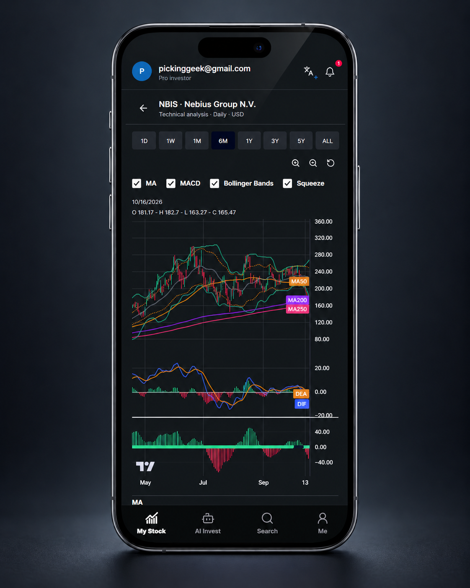
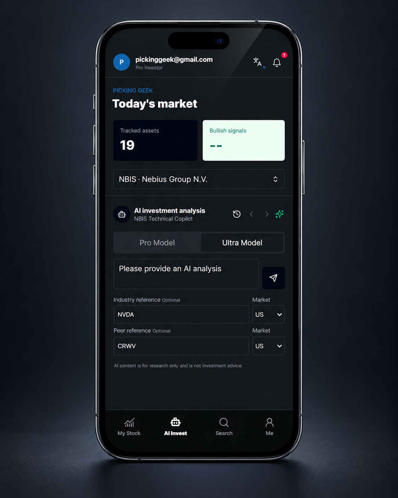
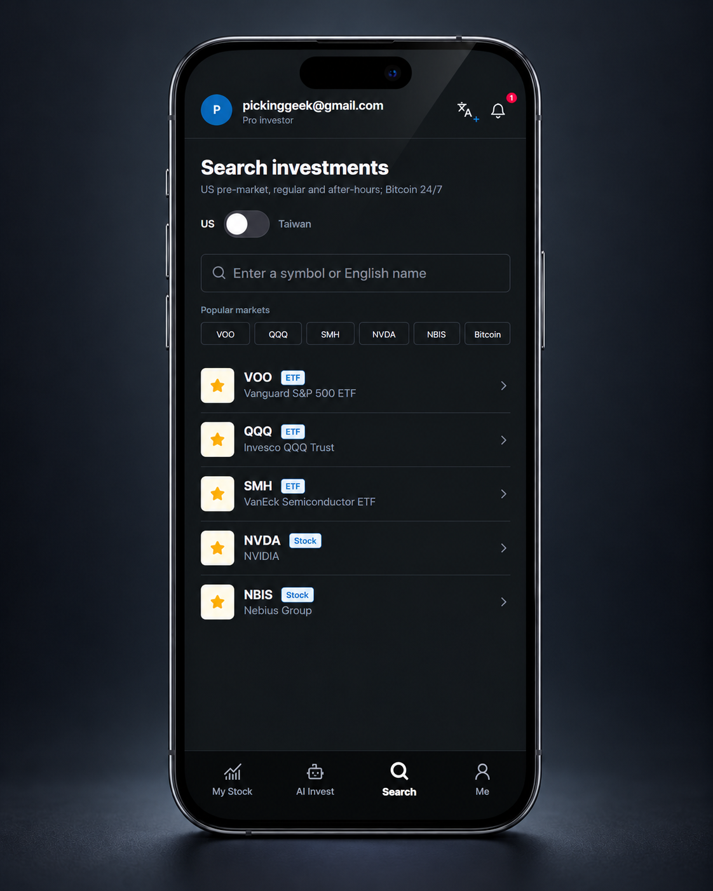
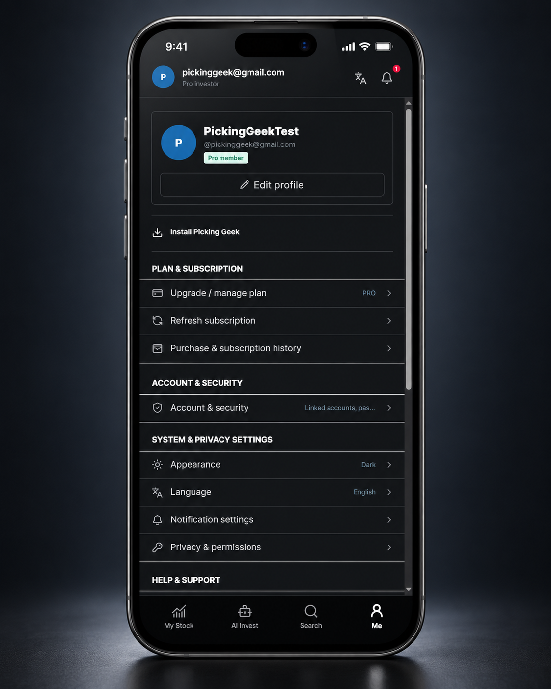
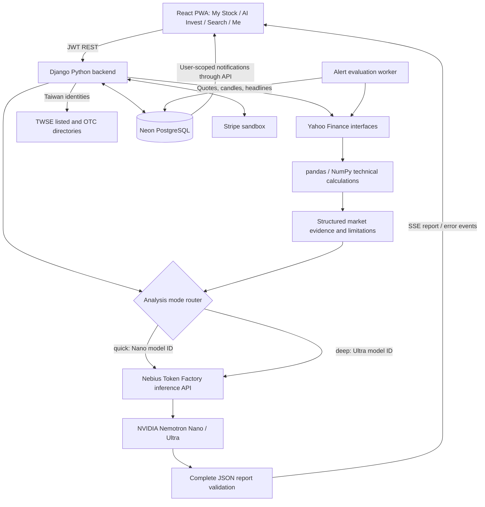

# Picking Geek AI - Investing Made Easy

**A financial data-grounded research copilot for US and Taiwan markets, powered by NVIDIA Nemotron through Nebius Token Factory.**

Picking Geek AI turns calculated technical signals into readable research. It is not just a chat interface: the Python backend retrieves market evidence, calculates indicators, assembles context, selects a model, validates its structured response, and presents the report with sources and data limitations.

A solo development project by James Chen for the **Nebius x NVIDIA Global AI Hackathon**.

> Research only. Not investment advice. No return, accuracy, or real-time data guarantee.

## Contents

1. [Live Demo and Demo Video](#01-live-demo-and-demo-video)
2. [Project Overview](#02-project-overview)
3. [Key Features](#03-key-features)
4. [Technology Stack](#04-technology-stack)
5. [System Architecture](#05-system-architecture)
6. [NVIDIA Nemotron and Nebius Integration](#06-nvidia-nemotron-and-nebius-integration)
7. [AI Analysis Workflow and Data Grounding](#07-ai-analysis-workflow-and-data-grounding)
8. [Challenges and Lessons Learned](#08-challenges-and-lessons-learned)
9. [Hackathon Development Updates](#09-hackathon-development-updates)
10. [Limitations and Disclaimer](#10-limitations-and-disclaimer)
11. [Roadmap](#11-roadmap)
12. [License and Acknowledgments](#12-license-and-acknowledgments)

## 01 Live Demo and Demo Video

- **Hosted application:** [pickinggeek002.onrender.com](https://pickinggeek002.onrender.com)
- **Source repository:** [JamesChenPoChih/pickinggeek002](https://github.com/JamesChenPoChih/pickinggeek002)
- **Demo video:** [Watch the Picking Geek AI demo on YouTube](https://www.youtube.com/watch?v=AII7ZVPmHHk)
- **Developer's Devpost portfolio:** [James Chen on Devpost](https://devpost.com/JamesChenPoChih)

The Devpost link above is the developer's portfolio, not a project-specific hackathon submission page.

The hosted service may need time to wake up. Market data and AI responses depend on external provider availability.

### Hackathon Demo Access

- **Account:** `DemoGuest`
- **Password:** `Demo*2479*`

This is a shared demonstration account without administrative privileges. Do not store private information in it.

Explore the hosted application or watch the demo video to see both analysis modes:

- **Pro Model:** Focused interpretation of four technical indicators.
- **Ultra Model:** Expanded research with optional comparison stocks and news-headline insights.

The designated non-admin demo account has shared daily allowances of **20 Pro analyses** and **3 Ultra analyses**, resetting at midnight in **Asia/Taipei**. Accepted submissions count toward the allowance, including provider failures and cancellations. Basic per-minute limits also apply. The daily policy requires the updated backend deployment. See [demo policy](docs/DEMO_ACCOUNT.md).

<table>
  <tr>
    <th>My Stock</th>
    <th>AI Invest</th>
    <th>Search</th>
    <th>Me</th>
  </tr>
  <tr>
    <td></td>
    <td></td>
    <td></td>
    <td></td>
  </tr>
</table>

## 02 Project Overview

Investors often see indicator values without understanding how they relate to one another. Picking Geek AI combines a watchlist, interactive charts, configurable alerts, and two research modes in a mobile-oriented React PWA.

| Mode | Configured inference model | Purpose |
| --- | --- | --- |
| **Pro Model** | `nvidia/NVIDIA-Nemotron-3-Nano-30B-A3B` | Focused interpretation of one stock's four technical indicators. |
| **Ultra Model** | `nvidia/Nemotron-3-Ultra-550b-a55b` | Expanded technical research, news headlines, and up to two optional reference stocks. |

The design uses Nano for focused technical interpretation and Ultra for a richer research context. Relative speed and accuracy have not been formally benchmarked.

## 03 Key Features

| Surface | Implemented functionality |
| --- | --- |
| **My Stock** | My List watchlist, US-first/Taiwan-second ordering, quote-refresh attempts every two seconds while visible, interactive charts, and stock alert settings. |
| **Stock detail** | Candlesticks, selectable MA60/100/200/250 overlays and colors, MACD, Bollinger Bands, Squeeze, zoom, pan, and touch gestures. |
| **AI Invest** | Pro/Ultra selection, fixed report sections, optional comparisons, English/Traditional Chinese output, in-session history, today's records, and model-specific loading attribution. |
| **Search** | US/Taiwan switch, symbol and Chinese-name lookup, listed/OTC identities, stocks and ETFs, recommendations, and watchlist addition. Coverage remains source-dependent. |
| **Me** | Account, appearance and language preferences, and Basic / Pro / Premium plans with Stripe sandbox Checkout and subscription management. |

Alerts cover MA, MACD, Bollinger Bands, and Squeeze conditions with once-only or daily frequency. A backend evaluator creates user-scoped notification records. Foreground polling displays in-app notices and an unread bell indicator. **OS-level Web Push, FCM, and APNs are not implemented.** See [alert documentation](docs/ALERTS.md).

The PWA includes install icons, a manifest, and an offline fallback. The service worker does not cache authenticated APIs or financial responses. Offline installation does not provide offline inference or market data. See [PWA documentation](docs/PWA.md).

## 04 Technology Stack

| Layer | Technology and responsibility |
| --- | --- |
| Client | React, TypeScript, Vite, Tailwind CSS, Lucide, and Lightweight Charts. |
| Backend | Python, Django, Django REST Framework, JWT, and Server-Sent Events (SSE). |
| Market processing | HTTPX, pandas, NumPy, Yahoo Finance interfaces, and Taiwan security directories. |
| Inference | OpenAI-compatible Python client targeting Nebius Token Factory; NVIDIA Nemotron Nano and Ultra. |
| Persistence | Neon PostgreSQL for users, watchlists, alert records, and billing state. |
| Knowledge groundwork | pgvector, document/chunk tables, and optional Qwen embeddings with 1,024 dimensions; not connected to AI Invest retrieval yet. |
| Integrations | Google Identity Services, optional Google Cloud Translation Basic v2, and Stripe sandbox. |
| Deployment | Render, Gunicorn, WhiteNoise, and a supervised alert-evaluation subprocess. |

## 05 System Architecture

**Nebius hosts model inference; NVIDIA Nemotron performs the language reasoning; Django prepares evidence and orchestrates calls; Neon stores application data.**

Core implementation: [market evidence assembly](backend/pickinggeek/services/analysis_context.py), [model routing and report validation](backend/pickinggeek/services/llm_router.py), and [research UI](frontend/src/components/mobile/AIAnalysisPanel.tsx).

## 06 NVIDIA Nemotron and Nebius Integration

The backend uses the `OpenAI` Python client as a protocol-compatible SDK with the **Nebius base URL**. The SDK package name does not mean OpenAI hosts inference. Credentials stay on the backend.

| Setting | Pro | Ultra |
| --- | --- | --- |
| API mode | `quick` | `deep` |
| Report fields | `summary`, `ma`, `macd`, `bollinger`, `squeeze` | Same fields plus `strategy`, `news` |
| Maximum completion tokens requested | 4,096 | 12,288 |
| Thinking request | Disabled | Enabled, with a requested 2,048-token thinking budget |
| Temperature | 0.2 | 0.2 |

These are client request settings, subject to provider/model support. The UI explicitly selects Pro or Ultra; API `auto` mode routes longer or strategy/risk-oriented questions to Ultra.

In the actual app, the provider response is streamed but **buffered until the complete JSON report validates**. Django then emits structured SSE events. Timeout, provider, and invalid-format failures produce an explicit error and manual retry action, not an automatic extra paid repair call. Schema validation checks structure, not the truth of every sentence.

## 07 AI Analysis Workflow and Data Grounding

1. An authenticated user selects a watched stock, question, language, and mode.
2. Django retrieves candles and computes MA, MACD, Bollinger Bands, and Squeeze. Research uses completed daily sessions rather than labeling a forming candle as a confirmed closing signal.
3. Computed relationships describe price-versus-average position, new crossovers, and momentum direction. Missing data and per-asset dates remain explicit.
4. Ultra optionally retrieves up to two reference stocks. News retrieval keeps up to four headlines per asset, preferring seven days and falling back to thirty days when necessary. Article bodies are not retrieved.
5. Structured JSON evidence is supplied to Nemotron with task-specific instructions and a required response schema.
6. The backend validates required nonempty fields. React renders fixed sections and news source links independently of generated prose.

### Model Selection and Prompt Engineering

Pro excludes news and peers so Nano can focus on a bounded technical interpretation. Ultra receives a richer context for conditional strategy, comparison, and news analysis. No benchmark is claimed for the relative model quality or latency.

Prompts distinguish facts, inferences, and unknowns, prohibit fabricated prices/sources, and treat headlines as untrusted evidence rather than instructions. They explain that a negative MACD histogram does not necessarily mean negative DIF, Squeeze OFF does not prove a new release, and bandwidth alone does not establish a historical volatility percentile.

Ultra compares only supplied references, does not invent competitors, and does not treat selected references as proof of commercial relationships. Missing personal risk information must not be replaced with specific position sizing or guaranteed returns. Output follows English or Traditional Chinese settings.

### Precise RAG Status

The current implementation is **Financial Data-Grounded AI Analysis**: external market evidence and retrieved headlines are included in the prompt. It does **not** perform semantic vector retrieval in AI Invest.

Knowledge groundwork defines `pickinggeek_knowledge_document` and `pickinggeek_knowledge_chunk` with `embedding vector(1024)`, plus popularity and refresh-state tables. Embedding storage is separate infrastructure; `build_analysis_context()` does not query those chunks today. End-to-end vector RAG, corpus ingestion, similarity thresholds, and retrieval evaluation are future work. Historical knowledge chunks must not replace current prices or freshly calculated indicators.

## 08 Challenges and Lessons Learned

| Challenge | Engineering response and boundary |
| --- | --- |
| Inconsistent model report layouts | Separate Pro/Ultra JSON schemas, backend validation, and fixed React sections; semantic correctness still requires review. |
| Live prices versus closing signals | Separate quote display from completed-session calculations and preserve each asset's data date. |
| Taiwan tickers and names | Preserve leading zeroes and `.TW` / `.TWO`; use directories and fallback lookup; return search identities without waiting for quote enrichment. Live coverage remains provider-dependent. |
| Duplicate or misleading alerts | Evaluate actual conditions, establish baselines, scope by user, enforce notification frequency, and coordinate writes transactionally. |
| Slow translation | Translate existing fields using Google rather than rerunning Nemotron; cache results and normalize Traditional Chinese. A separate Google key is required. |
| News overclaiming | Keep source metadata and distinguish headline-only evidence from article research. |
| Deployment consistency | Build the frontend and backend together on Render and manage hosted configuration separately. |

No controlled benchmark for inference latency, prediction accuracy, or trading returns is published in this repository.

## 09 Hackathon Development Updates

Solo-development contributions include React interaction design, Django APIs and data models, market integration, indicator calculations, alert evaluation, Nebius orchestration, structured reports, deployment configuration, and regression tests.

Development milestones include:

- US/Taiwan search and watchlists, Chinese names, ETFs, and market-specific identities.
- Interactive indicators, MA color settings, mobile layouts, and PWA installation/offline fallback.
- Stripe **sandbox** plans: Basic free, Pro USD 9.99/month, Premium USD 39.99/month, with webhook-based status synchronization rather than trusting browser return parameters.
- Document/chunk embedding groundwork, separate from current research generation.
- Pro/Ultra schemas, optional comparisons, news grounding, session history, and translation integration.

Git history records implementation milestones and commit dates.

## 10 Limitations and Disclaimer

- **Data:** Yahoo interfaces are unofficial and may change or rate-limit requests. Caching/fallbacks do not guarantee every listed/OTC instrument. Two-second polling is not exchange-certified real-time data.
- **AI:** Grounding and schemas do not eliminate hallucinations, misinterpretation, missing context, or stale evidence. Review original sources before making decisions.
- **News:** Headlines are retrieved, not full article research. References are optional selections, not verified competitors or partners.
- **Usage controls:** Designated demo accounts have persistent daily analysis allowances. General paid-tier model entitlements and global spending budgets remain future work; button names alone are not billing authorization controls.
- **Security:** API secrets remain on the backend. Authentication abuse prevention, token/session management, and deployment hardening remain development priorities. Public demos must not expose administrator accounts.
- **Delivery:** In-app alerts exist; background phone push does not. A sleeping host cannot reliably evaluate conditions.
- **History:** Analysis history and today's records live in the current frontend session, not a durable server-side archive.
- **Payments:** Stripe intentionally uses test mode. Live payments are not a completed launch feature.

Picking Geek AI is not a broker, financial adviser, or automated trading system. It does not execute trades or promise returns. Users are responsible for independent verification and their own decisions.

## 11 Roadmap

- Enforce backend model entitlements, durable quotas, concurrency limits, and operator spending ceilings.
- Harden login/session security and production deployment defaults.
- Connect reviewed document ingestion and Neon vector retrieval, with citations, expiry, and retrieval-quality tests.
- Add the project-specific Devpost submission link.
- Evaluate indicator interpretation and headline relevance with reproducible datasets.
- Add durable user-owned research history and supported background Web Push.
- Strengthen automated quality checks, dependency management, and provider integration monitoring.

## 12 License and Acknowledgments

Project code is available under the [MIT License](LICENSE).

Copyright (c) 2026 Hacker Moose AI, Inc.

Credits: [NVIDIA Nemotron](https://www.nvidia.com/en-us/ai/), [Nebius Token Factory](https://nebius.com/token-factory), [Neon](https://neon.com/), [Django](https://www.djangoproject.com/), [React](https://react.dev/), [TradingView Lightweight Charts](https://github.com/tradingview/lightweight-charts), [Stripe](https://stripe.com/), Google Identity Services and Cloud Translation, Taiwan Stock Exchange security directories, and Yahoo Finance interfaces. Qwen embeddings support the separate knowledge-storage experiments.

Third-party libraries, models, chart attribution requirements, and market/news content retain their own licenses and terms. The project's MIT license does not grant ownership or redistribution rights over third-party data and does not imply provider endorsement.
